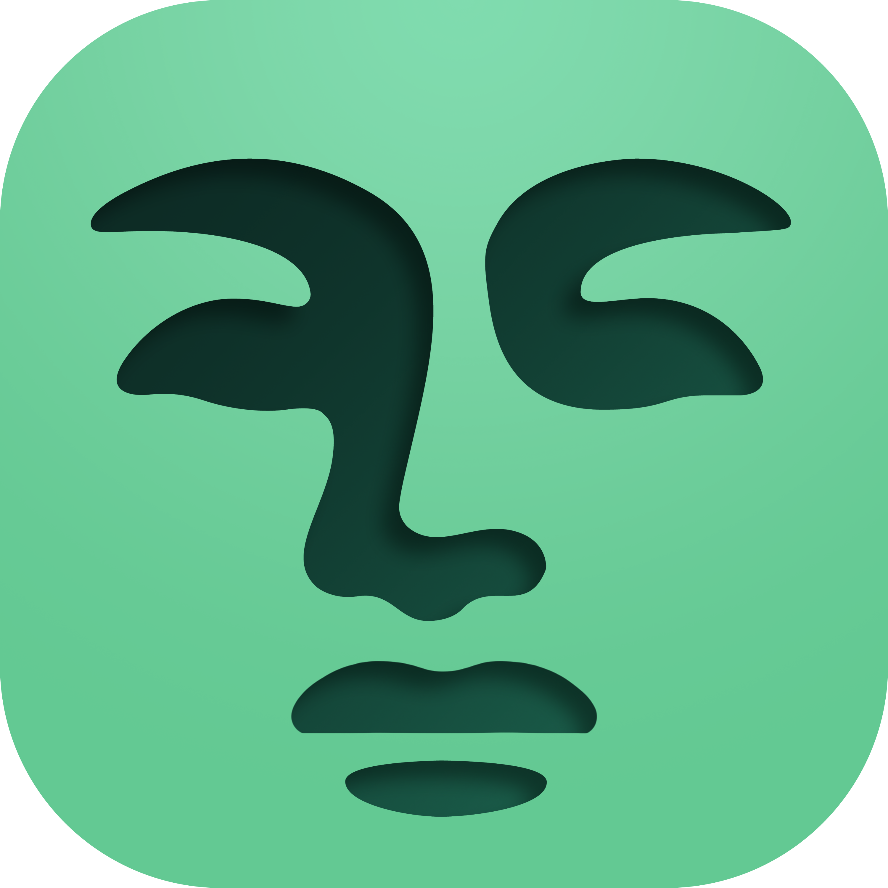

<p align="center">
  
</p>

<h1 align="center">Komal</h1>

<p align="center">
  <b>A node-based, non-destructive raster editor written in C++.</b><br>
  Paint on an infinite canvas, wire edits together in a graph, change your mind later.
</p>

<p align="center">
  
  
  
  
</p>

> [!WARNING]
> Komal is in active development and isn't ready for real work yet. Things will move, break and get renamed.

## What it does

- **Infinite canvas.** Pixels live in 64×64 tiles that only exist where you've painted, so the canvas has no edges.
- **Node graph.** Raster, Move and Compositor nodes wired together. Every edit stays live, so you can tweak an offset or a mix long after you made it.
- **GPU everywhere.** Rendering runs on WebGPU via wgpu-native (Vulkan, Metal, DX12). Tiles are drawn from texture atlases, with levels of detail when you zoom out.
- **Live previews.** Dragging a node's value previews the result on the GPU at full resolution, then commits when you let go.
- **Painting.** A brush with size, hardness, opacity, flow and spacing, an eraser, and primary/secondary colors (<kbd>X</kbd> swaps them).
- **Gets out of the way.** A dockable UI, cursor-anchored zoom, <kbd>F</kbd> to frame everything, and an idle loop that sits at ~0% CPU when nothing is happening.

## Building

You'll need CMake 3.24+, Ninja and a C++20 compiler. Everything else is downloaded at configure time. If SDL3 or abseil are installed system-wide, those are used instead.

```sh
# Linux
cmake --preset linux-release
cmake --build --preset linux-release
./build/linux-release/bin/Komal

# macOS
cmake --preset macos-release
cmake --build --preset macos-release

# Windows (Visual Studio 2022)
cmake --preset windows-msvc-x64
cmake --build --preset windows-msvc-x64-release
```

There are `-debug` variants of each, plus `windows-release` for cross-compiling from Linux with mingw-w64. On Linux, `cmake --install` puts the binary, a `.desktop` file and the icon in the usual places.

## Credits

Komal is built on top of some excellent open-source work:

| Project | What it's used for | License |
|---|---|---|
| [Dear ImGui](https://github.com/ocornut/imgui) | The whole UI | MIT |
| [Dear ImGui, docking branch](https://github.com/ocornut/imgui/tree/docking) | Dockable panels and layouts | MIT |
| [SDL3](https://github.com/libsdl-org/SDL) | Windows, input, events | zlib |
| [wgpu-native](https://github.com/gfx-rs/wgpu-native) | WebGPU rendering | MIT / Apache-2.0 |
| [Abseil](https://github.com/abseil/abseil-cpp) | Hash containers for tiles | Apache-2.0 |
| [stb](https://github.com/nothings/stb) | Image loading (`stb_image`) | MIT / Public domain |

Fonts:

| Font | Used for | License |
|---|---|---|
| [Manrope](https://github.com/sharanda/manrope) by Mikhail Sharanda | UI text | SIL OFL 1.1 |
| [JetBrains Mono](https://github.com/JetBrains/JetBrainsMono) by JetBrains | Number fields | SIL OFL 1.1 |

## License

Komal's source code is licensed under the [GNU General Public License v3.0](LICENSE).

The **Komal Studio name and logo** are the only exceptions. They are not covered by the GPL, are copyrighted, and all rights to them are reserved. If you fork Komal, please give your version its own name and icon.

Third-party libraries and fonts keep their own licenses, listed above.
